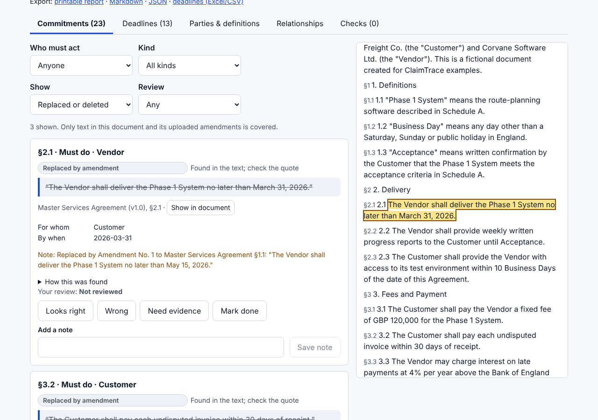

# ClaimTrace

**Upload documents. Map commitments and obligations. Ask questions. Verify every answer against the exact source.**

Website: [glowstonesq1.github.io/claimtrace](https://glowstonesq1.github.io/claimtrace/)

ClaimTrace is a local-first, open-source workspace for reading contracts, amendments, audit reports, policies
and delivery records. It builds a register of who owes what to whom, by when and under which conditions. It
answers questions only with verified quotes, and checks documents against each other. A typical check: did
the amendment change the delivery date, and was the system delivered by the date that now applies?

> **Not legal advice.** ClaimTrace helps you read documents. It does not decide what is true, what is legally
> binding, or what you should do. Every result quotes its source so you can check it.


<!-- Replace with a short screen recording of: load samples → register → ask → verify. -->

## Why this exists

Generic AI chat tools can summarise a PDF, but they don't hold a reviewable register across a contract and
its amendments. They also cite text that isn't there. ClaimTrace is built around three rules:

1. **Every claim is a quote.** Answers, commitments and findings point to exact character offsets in stored
   text, and are re-verified before they are shown or exported. If there's no supporting text, the answer is
   *"I could not find support for this in the uploaded documents."*
2. **Amendments are first-class.** Replaced clauses are kept and marked, never overwritten. Answers lead with
   the current wording and show what it replaced.
3. **Uncertainty is visible.** Passive voice, vague timing, ambiguous dates, exceptions and instruction-like
   text are flagged for review instead of being silently resolved.

## What v0.1 does

| Area | v0.1 |
|---|---|
| Ingestion | PDF (text layer), DOCX, Markdown, TXT; URL ingestion with SSRF protection, **off by default**. Parsing runs in a resource-limited subprocess. Scanned PDFs are detected and flagged. |
| Extraction | Parties, definitions, commitments (obligation, entitlement, prohibition, condition, consequence, service level), modality, deadlines (absolute, relative, recurring, vague), conditions, exceptions, cross-references, amendment instructions, factual statements in audit/evidence documents. |
| Graph | Provenance-carrying nodes and edges (made_by, owed_to, requires, conditioned_on, qualifies, references, amends, supersedes) in SQLite. |
| Ask | Grounded answers with status (stated / contradicted / not found / …), verified quotes, source locations, path, caveats and follow-ups. Amendment-aware and cross-document-aware. |
| Verify | Contract vs amendment, vs audit report or evidence, vs SOW/proposal/policy, and two versions of one document. Typed comparison of dates, amounts, percentages, durations, places and obligation strength. |
| Review | Append-only decisions (looks right, wrong, need evidence, note, handled), with reviewer name and time. |
| Export | Markdown, JSON (schema-versioned, with content hash), print-ready HTML, deadline CSV. |
| Models | Works fully offline with the rules engine. Optional OpenAI-compatible endpoint (OpenAI, Ollama, vLLM, LM Studio). Model output is schema-validated and quote-checked. Documents go to a non-local endpoint only with per-document approval. |

## Quickstart

### Option A — Python (no Docker)

```bash
git clone <repo-url> claimtrace && cd claimtrace
make dev          # creates .venv, installs the package, builds the web UI (needs Python 3.11+ and Node 20+)
make serve        # http://127.0.0.1:8000
```

Open http://127.0.0.1:8000 and click **Load sample documents**. API docs are at http://127.0.0.1:8000/docs.

### Option B — Docker Compose

```bash
docker compose up --build    # serves on 127.0.0.1:8000 only; data in the "claimtrace-data" volume
```

### Command line

```bash
claimtrace ingest examples/documents/msa-v1.md
claimtrace ingest examples/documents/amendment-1.md     # links to the contract via its front matter
claimtrace list
claimtrace ask "How many days does the customer have to pay invoices?"
claimtrace verify <contract-id> <amendment-id>
claimtrace report <contract-id> --format md
claimtrace report <contract-id> --format ics > deadlines.ics   # resolved deadlines as a calendar file
```

### Using a local model (optional)

```bash
ollama pull llama3.1
CLAIMTRACE_LLM_PROVIDER=ollama CLAIMTRACE_LLM_MODEL=llama3.1 claimtrace serve
```

The model adds commitments the rules missed and drafts answers. Anything it returns must pass schema
validation and verbatim quote checks, or it is discarded. Hosted providers (`CLAIMTRACE_LLM_PROVIDER=openai`,
`CLAIMTRACE_LLM_BASE_URL`, `CLAIMTRACE_LLM_API_KEY`) also require each document to be approved for sending
(`allow_external_llm`). Every send is logged at `/privacy/egress`.

## Example

Input: [a fictional contract](examples/documents/msa-v1.md), [an amendment](examples/documents/amendment-1.md),
[an audit report](examples/documents/audit-report-2026.md) and [a delivery record](examples/documents/delivery-record.md).

```text
$ claimtrace ask "Did the vendor promise delivery by March 31?"
[stated · confidence low]
Originally yes, but this was later changed. Master Services Agreement (v1.0), §2.1 says: "The Vendor shall
deliver the Phase 1 System no later than March 31, 2026." This was later replaced by Amendment No. 1 …
§1.1: "The Vendor shall deliver the Phase 1 System no later than May 15, 2026."
  conflicts: "The Vendor delivered the Phase 1 System on May 22, 2026." — Delivery and Acceptance Record §1.1
  note: … conflicts with this commitment: Done on 22 May 2026, after the deadline of 15 May 2026 (7 days late).

$ claimtrace verify <contract> <audit report>
- [contradicted · high] The Vendor shall ensure the Phase 1 System is available 99.5% …
    Measured 99.1% is below the committed 99.5%.
- [contradicted · high] The Vendor shall not transfer Customer data outside the United Kingdom …
    Location differs: commitment refers to United Kingdom; other document says Ireland.
- [partially_supported · medium] The Vendor shall maintain multi-factor authentication …
    … "However, two shared break-glass accounts were found without multi-factor authentication."
- [needs_human_review · medium] The Vendor shall notify the Customer of any personal data breach within 72 hours …
    Same period (72 hours) but a different starting point: "becoming aware of it" vs "confirming a breach".
```

Full outputs: [`examples/outputs/`](examples/outputs/). Sample questions: [`examples/documents/sample-questions.md`](examples/documents/sample-questions.md).

## API

| Method | Path | Purpose |
|---|---|---|
| POST | `/documents` | Upload a file (multipart) or a URL (if enabled) |
| GET | `/documents`, `/documents/{id}` | List; metadata, passages, parties, definitions |
| PATCH / DELETE | `/documents/{id}` | Edit metadata or links; delete everything derived from it |
| POST | `/documents/{id}/analyze` | Start analysis (202 + run; idempotent) — poll `/runs/{id}` |
| GET | `/documents/{id}/commitments` · `/claims` · `/graph` | Register (filters: type, party, status, due_before, needs_review), statements, graph |
| POST | `/ask` · GET `/answers/{id}` | Grounded question answering |
| POST | `/verify` · GET `/verifications/{id}` | Cross-document verification |
| POST | `/answers/{id}/review` · `/findings/{id}/review` · `/commitments/{id}/review` | Append-only review |
| GET | `/documents/{id}/report?format=json\|md\|html` · `/documents/{id}/deadlines.csv` · `/documents/{id}/deadlines.ics` | Exports |
| GET | `/health` · `/privacy/egress` · `/privacy/tombstones` | Status, LLM send log, deletion records |

```bash
curl -F file=@examples/documents/msa-v1.md http://127.0.0.1:8000/documents
curl -X POST http://127.0.0.1:8000/documents/<id>/analyze
curl -H 'Content-Type: application/json' -d '{"question":"What is the liability cap?"}' http://127.0.0.1:8000/ask
```

Errors always have the shape `{"error": {"code", "message", "details"}}` and never echo submitted text.

## Architecture

```
apps/web (React + Vite, static) ──► apps/api (FastAPI: security middleware, routes, reports)
                                         │
  ingestion ── extraction ── retrieval ── verification (ask, verify, reports) ── evaluation
       └──────────────┴──────── core (models, SQLite store, text) ───────┘
                                         │
                          integrations (LLM providers: rules / OpenAI-compatible / fake)
```

One Python distribution (`claimtrace`); the directories under `packages/` are its subpackages. See
[docs/architecture.md](docs/architecture.md), [data model](docs/data-model.md),
[commitment model](docs/commitment-model.md) and [question answering](docs/question-answering.md).

## Evaluation (v0.1.0, rules engine, no model)

Benchmark: 140 core cases plus 46 sealed holdout cases. Both sets are synthetic and were written by isolated
agents that did not see the code. The holdout set was never opened before scoring. Full protocol, definitions
and every number: [docs/evaluation.md](docs/evaluation.md).

| Metric | Sealed holdout | Keyword floor |
|---|---|---|
| Hallucination rate (lower is better) | **0.00** | 0.50 |
| False-clear rate (said "consistent" when it was not) | **0.03** | 0.29 |
| Contradiction detection, precision / recall | **0.82 / 0.64** | – / 0.00 |
| "Not found" recall | **1.00** | 0.00 |
| QA status accuracy | **0.88** (0.62–1.00) | 0.50 |
| Party attribution | **0.97** | 0.69 |
| Deadline accuracy | **0.83** (0.50–1.00) | 0.00 |
| Commitment recall | 0.88 (0.72–1.00) | 0.87 |
| Amendment verification accuracy | **0.61** (0.31–0.85) | 0.00 |
| Amendment effect accuracy | **0.50** (0.21–0.71) | – |

**Read this before trusting it:**
- Amendment handling scored 0.89 on the set used for error analysis but **0.61 on the holdout**. The
  instruction patterns are overfitted to the drafting styles seen during development. Check amendments
  yourself.
- On consistency checks the rules don't beat a constant "consistent" guess. The value is in catching
  contradictions and not giving false all-clears.
- The holdout has only 46 cases; the intervals are wide.
- No language-model baseline is published yet (none was available in the release environment).

## Limitations

- **Not legal advice**, no risk scores, no legal-effect analysis (governing law, order of precedence,
  enforceability).
- Scanned PDFs (no text layer) are flagged but not read. OCR is planned for v0.2.
- Tables and complex layouts are flattened to text. DOCX automatic numbering is not visible, so clause
  numbers may be missing.
- Paraphrased questions often get "not found" from the rules engine. The engine prefers abstaining to
  guessing; use the optional model for better recall.
- Places are compared with a small built-in gazetteer, so street addresses and unlisted cities aren't compared.
- Business-day deadlines are not converted to calendar dates.
- Prompt-injection detection is a heuristic. Instruction-like text is flagged, and model-only items from such
  passages are dropped, but text hidden in a PDF (white or tiny fonts) is not yet detected.
- Single user, no accounts. Reviewer names are self-declared and labelled as such in exports.

## Security and privacy

The server binds to `127.0.0.1` by default and refuses to start on another address without
`CLAIMTRACE_API_TOKEN`. It rejects cross-origin writes and unexpected Host headers (DNS rebinding). It sends
nothing to the internet by default; a test enforces this. Logs contain IDs and counts only. Deleting a
document removes all derived data (verified by a canary-string test on the database file) and leaves a
content-free tombstone. Details: [docs/security.md](docs/security.md), [docs/privacy.md](docs/privacy.md),
[SECURITY.md](SECURITY.md).

## Roadmap, contributing, licence

- [Roadmap](docs/roadmap.md) — v0.2 starts with amendment generalisation, OCR and an external held-out set.
- [Contributing](docs/contributing.md) and [good first issues](docs/good-first-issues.md).
- [Design review](docs/design-review.md) — the 11-reviewer panel and the 24 decisions behind v0.1.
- Licensed under [Apache-2.0](LICENSE). See [NOTICE.md](NOTICE.md) for third-party components.
