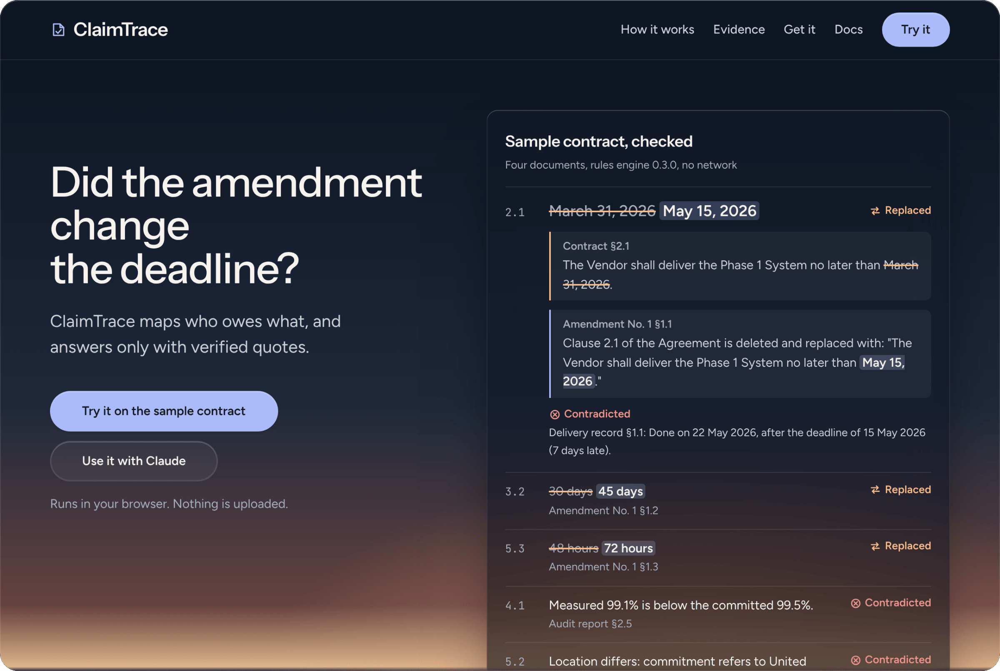
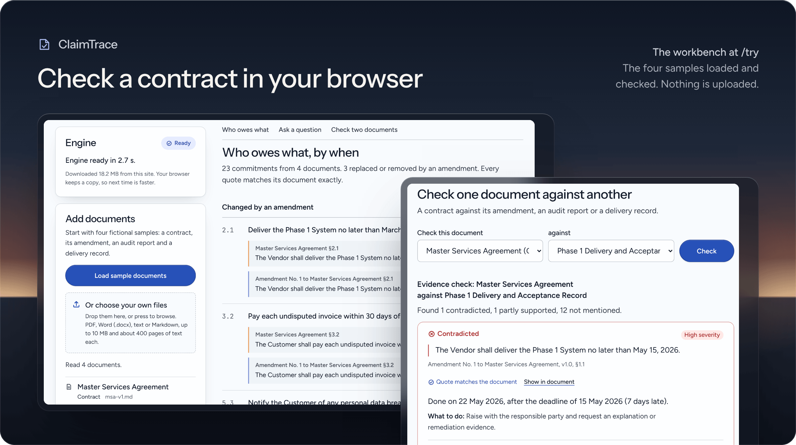
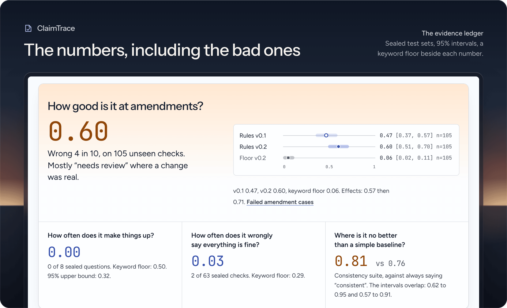
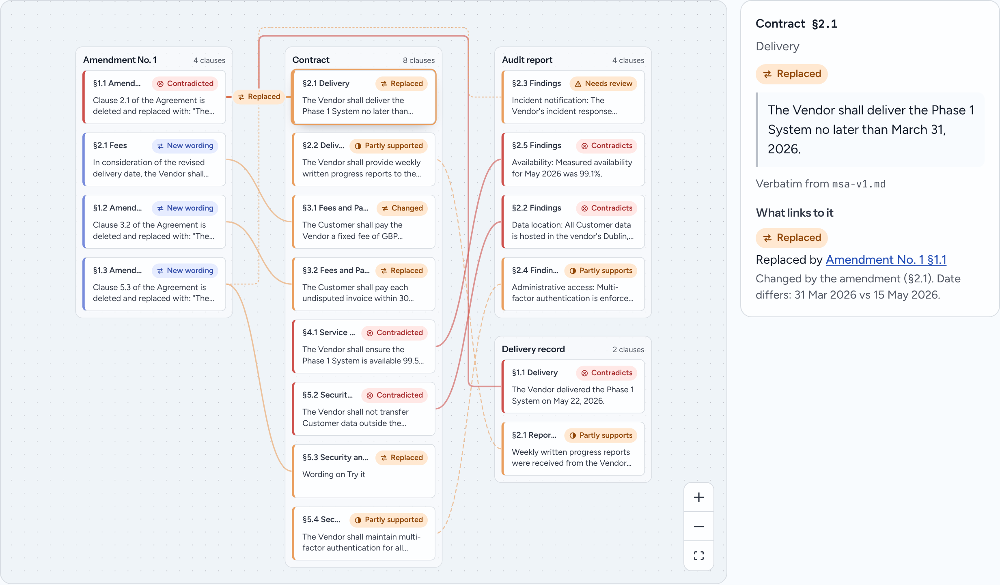
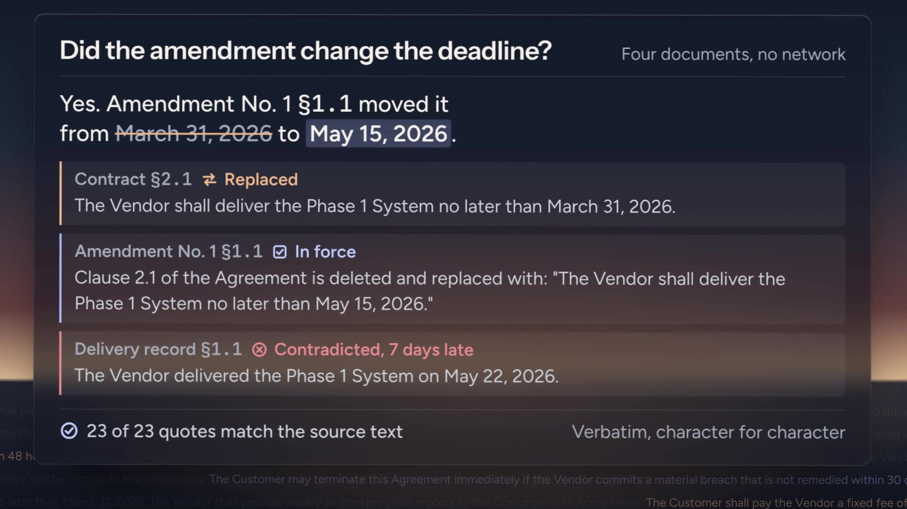

# ClaimTrace

<a href="https://glowstonesq1.github.io/claimtrace/"></a>

**Read a contract and its amendments with a quote behind every answer.**

ClaimTrace lists who owes what to whom, by when. It answers questions only with quotes it has checked against
the source. It checks one document against another: did the amendment change the delivery date, and was the
system delivered by the date that now applies? It is local-first and open source.

[](https://github.com/glowstonesq1/claimtrace/actions/workflows/ci.yml)
[](LICENSE)

> **Not legal advice.** ClaimTrace helps you read documents. It does not decide what is true, what is legally
> binding, or what you should do. Every result quotes its source so you can check it.

## Three ways to use it

| Way | Where your documents go | Start here |
|---|---|---|
| **In your browser** | Nowhere. The engine runs in the tab and nothing is uploaded. | [Try it on the samples](https://glowstonesq1.github.io/claimtrace/try/) |
| **With Claude**: a skill for claude.ai, a plugin for Claude Code | To Anthropic, under your Claude plan's terms | [Use ClaimTrace in Claude](docs/claude.md) |
| **Self-host**: Python or Docker | Nowhere. The server listens on `127.0.0.1` only. | [Quickstart](#quickstart) |

All three run the same engine. The website compares them on its [Get it](https://glowstonesq1.github.io/claimtrace/get/) page.



## How good it is

These are the rules engine's numbers on sealed test cases that nobody opened before the code was frozen. The
keyword floor is a trivial baseline, there so each number has something to beat. Full protocol, definitions
and every number: [docs/evaluation.md](docs/evaluation.md).

| Metric | Sealed holdout | Keyword floor |
|---|---|---|
| Hallucination rate (lower is better) | **0.00** | 0.50 |
| False-clear rate (said "consistent" when it was not) | **0.03** | 0.29 |
| Contradiction detection, precision / recall | **0.83 / 0.71** | – / 0.00 |
| "Not found" recall | **1.00** | 0.00 |
| QA status accuracy | **0.88** (0.62–1.00) | 0.50 |
| Party attribution | **0.97** | 0.69 |
| Deadline accuracy | **0.83** (0.50–1.00) | 0.00 |
| Commitment recall | 0.88 (0.72–1.00) | 0.87 |
| Amendment verdict accuracy, sealed amendment set (n=105) | **0.60** (0.51–0.70); v0.1 was 0.47 | 0.06 |
| Amendment effect accuracy, sealed amendment set (n=91) | **0.71** (0.62–0.80); v0.1 was 0.57 | – |

v0.2 rules engine, no language model. Ranges are 95% bootstrap intervals.

**Read this before trusting it:**
- **Four in ten amendment verdicts are still wrong** on wording the engine had not seen. Usually it says "needs
  review" where a change was real. Check amendments yourself.
- On consistency checks the rules don't beat a constant "consistent" guess. The value is in catching
  contradictions and not giving false all-clears.
- The holdout has only 46 cases, so the intervals are wide.
- No language-model baseline is published yet (none was available in the release environment).

<details>
<summary>How the test sets were built</summary>

Benchmark: 140 core cases, 46 sealed holdout cases (scored at v0.1 and v0.2) and 50 sealed amendment cases
(added in v0.2). The sealed sets were scored without tuning, and re-scored once after the v0.2 review fixes with
identical results. Both sets are synthetic and were written by isolated agents that did not see the code. The
holdout set was never opened before scoring.

</details>

<a href="https://glowstonesq1.github.io/claimtrace/evidence/"></a>

Every metric with its interval, and every case we can show, is on the
[evidence page](https://glowstonesq1.github.io/claimtrace/evidence/).

## Every finding points back to a clause

<a href="https://glowstonesq1.github.io/claimtrace/#how"></a>

ClaimTrace is built around three rules:

1. **Every claim is a quote.** Answers, commitments and findings point to exact character offsets in stored
   text. They are re-verified before they are shown or exported. If there's no supporting text, the answer is
   *"I could not find support for this in the uploaded documents."*
2. **Amendments are first-class.** Replaced clauses are kept and marked, never overwritten. Answers lead with
   the current wording and show what it replaced.
3. **Uncertainty is visible.** Passive voice, vague timing, ambiguous dates, exceptions and instruction-like
   text are flagged for review instead of being silently resolved.

Generic AI chat tools can summarise a PDF. But they don't keep a reviewable register across a contract and its
amendments, and they cite text that isn't there.

## Watch it check the samples

<a href="https://glowstonesq1.github.io/claimtrace/media/claimtrace-film.mp4"></a>

A 50-second film in one continuous take: the four sample documents, the amendment, the contradictions, the
answer. [Play the film](https://glowstonesq1.github.io/claimtrace/media/claimtrace-film.mp4) or watch it on the
[website](https://glowstonesq1.github.io/claimtrace/).

## Details

### What it does

| Area | What it does |
|---|---|
| Ingestion | PDF (text layer), DOCX, Markdown, TXT; URL ingestion with SSRF protection, **off by default**. Parsing runs in a resource-limited subprocess. Scanned PDFs are detected and flagged, and read with the optional OCR extra. |
| Extraction | Parties, definitions, commitments (obligation, entitlement, prohibition, condition, consequence, service level), modality, deadlines (absolute, relative, recurring, vague), conditions, exceptions, cross-references, amendment instructions, factual statements in audit/evidence documents. |
| Graph | Provenance-carrying nodes and edges (made_by, owed_to, requires, conditioned_on, qualifies, references, amends, supersedes) in SQLite. |
| Ask | Grounded answers with status (stated / contradicted / not found / …), verified quotes, source locations, path, caveats and follow-ups. Amendment-aware and cross-document-aware. |
| Verify | Contract vs amendment, vs audit report or evidence, vs SOW/proposal/policy, and two versions of one document. Typed comparison of dates, amounts, percentages, durations, places and obligation strength. |
| Review | Append-only decisions (looks right, wrong, need evidence, note, handled), with reviewer name and time. |
| Export | Markdown, JSON (schema-versioned, with content hash), print-ready HTML, deadline CSV and ICS. |
| Models | Works fully offline with the rules engine. Optional OpenAI-compatible endpoint (OpenAI, Ollama, vLLM, LM Studio). Model output is schema-validated and quote-checked. Documents go to a non-local endpoint only with per-document approval. |

### Quickstart

**No install:** use ClaimTrace [in your browser](https://glowstonesq1.github.io/claimtrace/try/), in claude.ai
(skill zip) or in Claude Code (`/plugin marketplace add glowstonesq1/claimtrace`, then
`/plugin install claimtrace@claimtrace`); see [docs/claude.md](docs/claude.md).

**Python (no Docker):**

```bash
git clone <repo-url> claimtrace && cd claimtrace
make dev          # creates .venv, installs the package, builds the web UI (needs Python 3.11+ and Node 20+)
make serve        # http://127.0.0.1:8000
```

Open http://127.0.0.1:8000 and click **Load sample documents**. API docs are at http://127.0.0.1:8000/docs.

**Docker Compose:**

```bash
docker compose up --build    # serves on 127.0.0.1:8000 only; data in the "claimtrace-data" volume
```

**Command line:**

```bash
claimtrace ingest examples/documents/msa-v1.md
claimtrace ingest examples/documents/amendment-1.md     # links to the contract via its front matter
claimtrace list
claimtrace ask "How many days does the customer have to pay invoices?"
claimtrace verify <contract-id> <amendment-id>
claimtrace report <contract-id> --format md
claimtrace report <contract-id> --format ics > deadlines.ics   # resolved deadlines as a calendar file
```

**A local model (optional):**

```bash
ollama pull llama3.1
CLAIMTRACE_LLM_PROVIDER=ollama CLAIMTRACE_LLM_MODEL=llama3.1 claimtrace serve
```

The model adds commitments the rules missed and drafts answers. Anything it returns must pass schema
validation and verbatim quote checks, or it is discarded. Hosted providers (`CLAIMTRACE_LLM_PROVIDER=openai`,
`CLAIMTRACE_LLM_BASE_URL`, `CLAIMTRACE_LLM_API_KEY`) also require each document to be approved for sending
(`allow_external_llm`). Every send is logged at `/privacy/egress`.

**Scanned PDFs (optional):** `pip install 'claimtrace[ocr]'` and install Tesseract. Each OCR page carries a
confidence, and low-confidence pages get a warning.

### Example

Input: [a fictional contract](examples/documents/msa-v1.md), [an amendment](examples/documents/amendment-1.md),
[an audit report](examples/documents/audit-report-2026.md) and [a delivery record](examples/documents/delivery-record.md).

```text
$ claimtrace ask "Did the vendor promise delivery by March 31?"
[stated · confidence low]
Originally yes, but this was later changed. Master Services Agreement (v1.0), §2.1 says: "The Vendor shall
deliver the Phase 1 System no later than March 31, 2026." This was later replaced by Amendment No. 1 …
§1.1: "The Vendor shall deliver the Phase 1 System no later than May 15, 2026."
  conflicts: "The Vendor delivered the Phase 1 System on May 22, 2026." — Delivery and Acceptance Record §1.1
  note: … conflicts with this commitment: Done on 22 May 2026, after the deadline of 15 May 2026 (7 days late).

$ claimtrace verify <contract> <audit report>
- [contradicted · high] The Vendor shall ensure the Phase 1 System is available 99.5% …
    Measured 99.1% is below the committed 99.5%.
- [contradicted · high] The Vendor shall not transfer Customer data outside the United Kingdom …
    Location differs: commitment refers to United Kingdom; other document says Ireland.
- [partially_supported · medium] The Vendor shall maintain multi-factor authentication …
    … "However, two shared break-glass accounts were found without multi-factor authentication."
- [needs_human_review · medium] The Vendor shall notify the Customer of any personal data breach within 72 hours …
    Same period (72 hours) but a different starting point: "becoming aware of it" vs "confirming a breach".
```

Full outputs: [`examples/outputs/`](examples/outputs/). Sample questions: [`examples/documents/sample-questions.md`](examples/documents/sample-questions.md).

### API

| Method | Path | Purpose |
|---|---|---|
| POST | `/documents` | Upload a file (multipart) or a URL (if enabled) |
| GET | `/documents`, `/documents/{id}` | List; metadata, passages, parties, definitions |
| PATCH / DELETE | `/documents/{id}` | Edit metadata or links; delete everything derived from it |
| POST | `/documents/{id}/analyze` | Start analysis (202 + run; idempotent) — poll `/runs/{id}` |
| GET | `/documents/{id}/commitments` · `/claims` · `/graph` | Register (filters: type, party, status, due_before, needs_review), statements, graph |
| POST | `/ask` · GET `/answers/{id}` | Grounded question answering |
| POST | `/verify` · GET `/verifications/{id}` | Cross-document verification |
| POST | `/answers/{id}/review` · `/findings/{id}/review` · `/commitments/{id}/review` | Append-only review |
| GET | `/documents/{id}/report?format=json\|md\|html` · `/documents/{id}/deadlines.csv` · `/documents/{id}/deadlines.ics` | Exports |
| GET | `/health` · `/privacy/egress` · `/privacy/tombstones` | Status, LLM send log, deletion records |

```bash
curl -F file=@examples/documents/msa-v1.md http://127.0.0.1:8000/documents
curl -X POST http://127.0.0.1:8000/documents/<id>/analyze
curl -H 'Content-Type: application/json' -d '{"question":"What is the liability cap?"}' http://127.0.0.1:8000/ask
```

Errors always have the shape `{"error": {"code", "message", "details"}}` and never echo submitted text.

### How it works

```
apps/web (React + Vite, static) ──► apps/api (FastAPI: security middleware, routes, reports)
                                         │
  ingestion ── extraction ── retrieval ── verification (ask, verify, reports) ── evaluation
       └──────────────┴──────── core (models, SQLite store, text) ───────┘
                                         │
                          integrations (LLM providers: rules / OpenAI-compatible / fake)
```

One Python distribution (`claimtrace`); the directories under `packages/` are its subpackages. The browser
version runs the same package under Pyodide. See [docs/architecture.md](docs/architecture.md),
[data model](docs/data-model.md), [commitment model](docs/commitment-model.md) and
[question answering](docs/question-answering.md).

### Limitations

- **Not legal advice**, no risk scores, no legal-effect analysis (governing law, order of precedence,
  enforceability).
- Scanned PDFs (no text layer) are flagged but not read unless the optional OCR extra is installed. The browser
  version has no OCR.
- PDF tables and complex layouts are flattened to text; DOCX table rows are kept as passages. DOCX automatic
  numbering is not visible, so clause numbers may be missing.
- Paraphrased questions often get "not found" from the rules engine. The engine prefers abstaining to
  guessing; use the optional model for better recall.
- Places are compared with a small built-in gazetteer, so street addresses and unlisted cities aren't compared.
- Prompt-injection detection is a heuristic. Instruction-like text is flagged and never sent to a model.
- Single user, no accounts. Reviewer names are self-declared and labelled as such in exports.

### Security and privacy

The server binds to `127.0.0.1` by default and refuses to start on another address without
`CLAIMTRACE_API_TOKEN`. It rejects cross-origin writes and unexpected Host headers (DNS rebinding). It sends
nothing to the internet by default; a test enforces this. Logs contain IDs and counts only. Deleting a
document removes all derived data (verified by a canary-string test on the database file) and leaves a
content-free tombstone. The browser version may only talk to its own site, and a test fails on any request that
leaves it. Details: [docs/security.md](docs/security.md), [docs/privacy.md](docs/privacy.md),
[SECURITY.md](SECURITY.md).

### Project layout

| Path | What is there |
|---|---|
| [`packages/`](packages/) | The engine: ingestion, extraction, retrieval, verification, evaluation, core, integrations, CLI, and the in-browser facade |
| [`apps/api/`](apps/api/), [`apps/web/`](apps/web/) | The self-hosted server and its web UI |
| [`apps/site/`](apps/site/) | The website, including [/try](apps/site/try/) and [/evidence](apps/site/evidence/) |
| [`apps/film/`](apps/film/) | The source of the film |
| [`plugins/claimtrace/`](plugins/claimtrace/) | The claude.ai skill and the Claude Code plugin |
| [`evals/`](evals/) | Test-set schema, datasets and published runs |
| [`examples/`](examples/) | The four fictional sample documents and their outputs |
| [`scripts/`](scripts/) | Site data, link checks, the browser bundle and the skill zips |
| [`docs/`](docs/) | Architecture, evaluation, security, privacy, roadmap; [figure sources](docs/img/frames/) |

### Development

```bash
make dev                                   # set up .venv and build the web UI
make check                                 # ruff, mypy and pytest: what CI gates on
python scripts/build_site_data.py --check  # the site's numbers match the published runs
python scripts/check_links.py              # every internal link on the site resolves
make eval                                  # run the core evaluation suite
```

The [changelog](CHANGELOG.md) lists what changed in each release.

### Roadmap, contributing, licence

- [Roadmap](docs/roadmap.md): an external held-out set, language-model baselines, table structure.
- [Contributing](docs/contributing.md) and [good first issues](docs/good-first-issues.md).
- [Design review](docs/design-review.md): the 11-reviewer panel and the 24 decisions behind v0.1.
- Licensed under [Apache-2.0](LICENSE). See [NOTICE.md](NOTICE.md) for third-party components.
